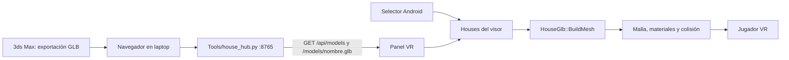

# Arquitectura del sandbox VR

## Flujo de datos

El hub es local. Por USB, `adb reverse tcp:8765 tcp:8765` hace que `127.0.0.1:8765` del visor llegue a la laptop. Por Wi-Fi se usa la IP de la laptop y el mismo puerto. El panel recuerda la URL del hub en `Houses/hub_address.txt`.

## Componentes

`AHouseSandboxGameMode` crea el panel, busca modelos locales, consulta el hub, descarga el GLB y gestiona el selector Android. `AHouseMenuInputActor` conecta el control derecho al panel y procesa desplazamiento y giro. El mapa inicial es `/Game/XRFramework/Levels/L_XRTemplate` y el pawn procede de `/Game/XRFramework/Blueprints/BP_XRPawn`.

El control derecho proyecta un láser cian hasta el primer impacto del puntero de widgets cuando el menú está abierto, y los botones cambian a un fondo de alto contraste al apuntarlos. Los marcadores de voz limitan su redibujado a 10 Hz durante el pulso del borde; Resonance Audio usa calidad binaural baja en Quest para reducir el coste por fotograma.

Al iniciar, `PlaceMenuAtPlayer` oculta la geometría de muestra de `L_XRTemplate` antes de mostrar la biblioteca. Así el suelo del mapa no tapa el widget 3D del menú. La misma limpieza se repite al cargar un GLB.

Los cuatro botones de los acordes se registran como acciones booleanas en `Content/HouseInput/IMC_HouseButtons`. `Config/DefaultInput.ini` activa ese contexto al iniciar OpenXR y `AHouseMenuInputActor` escucha `Started`, `Completed` y `Canceled` mediante `UEnhancedInputComponent`. Las pulsaciones de X/Y/A/B y los acordes completados se registran con el prefijo `HouseSandbox:` para diagnosticar el visor.

`HouseGlb::BuildMesh` valida cabecera y bloques GLB 2.0, recorre nodos y transformaciones, lee primitivas trianguladas e imágenes PNG/JPEG embebidas, y construye secciones de `UProceduralMeshComponent`. El cambio de ejes glTF → Unreal invierte la orientación; se invierten índices y se crea una cara opuesta cuando cabe en el límite. Esto conserva color en el interior de habitaciones cuya geometría mira hacia fuera. La malla usa colisión compleja para recorrer paredes y muebles.

La caja del modelo se centra horizontalmente. El importador estima el suelo por el área horizontal dominante de la mitad inferior, mueve el modelo para que ese suelo quede en Z=0 y busca cerca del centro un punto de entrada con suelo y espacio libre alrededor. La escala es 100 unidades Unreal por metro GLB.

## Estado de materiales

El perfil Referencia usa `Widget3DPassThrough_*_OneSided`, ya incluidos en el release probado. Los perfiles iluminados de la rama `feature/render-vr-menus` usan tres materiales nuevos `Default Lit` para `OPAQUE`, `MASK` y `BLEND`. El importador lee `baseColorTexture`, `metallicRoughnessTexture`, `normalTexture`, `occlusionTexture` y `emissiveTexture`, sus factores glTF y tangentes calculadas para UV0. Omite mapas que usan otra coordenada de textura y lo registra en `HouseSandbox:`. Las sombras direccionales se pueden activar de forma experimental; AO de pantalla y sombras calculadas por cada luz glTF no están implementadas. Los materiales nuevos están cocinados en `matrix-vr-show`; la última calibración de luz sigue pendiente de validación visual en Quest.

La escena iluminada combina un sol móvil sin sombras por defecto, una luz de relleno junto a la cámara y un Sky Light móvil con un cubemap incluido en el cocinado. El panel visual permite ajustar la luz ambiental y persiste la selección en `Houses/visual_settings.json`. La revisión de octubre de 2026 reduce la intensidad del sol y aumenta el rango de luz ambiental; su resultado visual requiere una nueva comprobación en Quest.

La configuración contiene opciones generales de Unreal como MSAA móvil, pero algunas funciones de escritorio presentes en `DefaultEngine.ini` no están disponibles en el renderizador Quest. No cambies los ajustes visuales basándote solo en el INI; valida en el visor.

## Límites y rendimiento

| Recurso | Límite actual | Código |
| --- | ---: | --- |
| Archivo GLB | 150 MiB | `HouseSandbox.cpp`, `HouseSandbox_UPL.xml` y `house_hub.py` |
| Triángulos renderizados | 350 000, incluidas caras duplicadas | `GlbRuntime.cpp` |
| Texturas descomprimidas | 128 MiB por importación | `GlbRuntime.cpp` |
| Dimensión de imagen de entrada | 4096 px por lado | `GlbRuntime.cpp` |
| Dimensión tras reducción | máximo global de 1024, 512, 256, 128 o 64 px por lado, elegido según la memoria estimada | `GlbRuntime.cpp` |
| Profundidad de nodos | 128 niveles | `GlbRuntime.cpp` |

La lectura y construcción son sincrónicas en el hilo de juego; un GLB grande puede detener la imagen durante decenas de segundos. Una carga del dormitorio mostró 159 variantes de imagen, de las cuales solo 68 se decodificaron antes de agotar los 128 MiB. El importador ahora estima el coste de todas las variantes requeridas y reduce su tamaño de forma uniforme antes de decodificarlas. La corrección requiere comprobarse en el visor. Prioriza mantener la fluidez de navegación al optimizar esta ruta.

## Persistencia

- Laptop: `Tools/models/` contiene los GLB subidos y los ejemplos versionados.
- Quest: el directorio persistente privado de la app, subcarpeta `Houses`, guarda descargas y archivos elegidos. En el dispositivo probado aparece bajo `/sdcard/Android/data/com.Allnovu.testMeta/files/Houses`.
- Las opciones visuales se guardan en `Houses/visual_settings.json` y se pueden cambiar desde el panel abierto con **X + Y**.
- Las partidas se guardan en `Houses/Saves/<nombre>.json` mediante escritura temporal y reemplazo. Cada archivo referencia el GLB local e incluye posicion, giro y notas en coordenadas Unreal; el GLB debe seguir disponible. Las notas son widgets de mundo con colision solo de visibilidad para el puntero, sin bloqueo del jugador.
- Las notas de voz comparten el anclaje de las notas de texto. Android `AudioRecord` captura PCM mono de 16 kHz tras pedir permiso de micrófono; cada grabación de hasta 30 s se guarda como WAV en `Houses/Voice/<id>.wav`. La partida versión 2 referencia esos archivos y conserva pausa y silencio; el lector admite partidas versión 1. Un componente de audio por marcador reproduce el clip con atenuación esférica y Resonance Audio binaural en Quest. Resonance Audio requiere configurar tanto `SpatializationPlugin` como `ReverbPlugin` en Android y cocinar su submix de salida para entregar la señal al mezclador. El marcador se ilumina y muestra una bocina mientras suena. Los WAV se conservan aunque se elimine una nota para no romper otras partidas guardadas que puedan referenciarlos.
- La app no usa una nube externa ni FTP. El transporte actual es HTTP local y copia al almacenamiento del visor.
