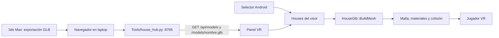

# Arquitectura del sandbox VR

## Flujo de datos

El hub es local. Por USB, `adb reverse tcp:8765 tcp:8765` hace que `127.0.0.1:8765` del visor llegue a la laptop. Por Wi-Fi se usa la IP de la laptop y el mismo puerto. El panel recuerda la URL del hub en `Houses/hub_address.txt`.

## Componentes

`AHouseSandboxGameMode` crea el panel, busca modelos locales, consulta el hub, descarga el GLB y gestiona el selector Android. `AHouseMenuInputActor` conecta el control derecho al panel y procesa desplazamiento y giro. El mapa inicial es `/Game/XRFramework/Levels/L_XRTemplate` y el pawn procede de `/Game/XRFramework/Blueprints/BP_XRPawn`.

Los cuatro botones de los acordes se registran como acciones booleanas en `Content/HouseInput/IMC_HouseButtons`. `Config/DefaultInput.ini` activa ese contexto al iniciar OpenXR y `AHouseMenuInputActor` escucha `Started`, `Completed` y `Canceled` mediante `UEnhancedInputComponent`. Las pulsaciones de X/Y/A/B y los acordes completados se registran con el prefijo `HouseSandbox:` para diagnosticar el visor.

`HouseGlb::BuildMesh` valida cabecera y bloques GLB 2.0, recorre nodos y transformaciones, lee primitivas trianguladas e imágenes PNG/JPEG embebidas, y construye secciones de `UProceduralMeshComponent`. El cambio de ejes glTF → Unreal invierte la orientación; se invierten índices y se crea una cara opuesta cuando cabe en el límite. Esto conserva color en el interior de habitaciones cuya geometría mira hacia fuera. La malla usa colisión compleja para recorrer paredes y muebles.

La caja del modelo se centra horizontalmente. El importador estima el suelo por el área horizontal dominante de la mitad inferior, mueve el modelo para que ese suelo quede en Z=0 y coloca al pawn en el origen. La escala es 100 unidades Unreal por metro GLB.

## Estado de materiales

El perfil Referencia usa `Widget3DPassThrough_*_OneSided`, ya incluidos en el release probado. Los perfiles iluminados de la rama `feature/render-vr-menus` usan tres materiales nuevos `Default Lit` para `OPAQUE`, `MASK` y `BLEND`. El importador lee `baseColorTexture`, `metallicRoughnessTexture`, `normalTexture`, `occlusionTexture` y `emissiveTexture`, sus factores glTF y tangentes calculadas para UV0. Omite mapas que usan otra coordenada de textura y lo registra en `HouseSandbox:`. Las sombras direccionales se pueden activar de forma experimental; AO de pantalla y sombras calculadas por cada luz glTF no están implementadas. Los materiales nuevos están cocinados en el candidato Android ASTC y necesitan validación visual en Quest antes de considerarse parte del release probado.

La configuración contiene opciones generales de Unreal como MSAA móvil, pero algunas funciones de escritorio presentes en `DefaultEngine.ini` no están disponibles en el renderizador Quest. No cambies los ajustes visuales basándote solo en el INI; valida en el visor.

## Límites y rendimiento

| Recurso | Límite actual | Código |
| --- | ---: | --- |
| Archivo GLB | 100 MiB | `HouseSandbox.cpp` y `house_hub.py` |
| Triángulos renderizados | 350 000, incluidas caras duplicadas | `GlbRuntime.cpp` |
| Texturas descomprimidas | 128 MiB por importación | `GlbRuntime.cpp` |
| Dimensión de imagen de entrada | 4096 px por lado | `GlbRuntime.cpp` |
| Dimensión tras reducción | cerca de 1024 px por lado | `GlbRuntime.cpp` |
| Profundidad de nodos | 128 niveles | `GlbRuntime.cpp` |

La lectura y construcción son sincrónicas en el hilo de juego; un GLB grande puede detener la imagen durante decenas de segundos. En una prueba del dormitorio de 33,5 MB se observaron 67 imágenes, 107,2 MiB decodificados y 133 490 triángulos tras duplicar caras. Prioriza mantener la fluidez de navegación al optimizar esta ruta.

## Persistencia

- Laptop: `Tools/models/` contiene los GLB subidos y los ejemplos versionados.
- Quest: el directorio persistente privado de la app, subcarpeta `Houses`, guarda descargas y archivos elegidos. En el dispositivo probado aparece bajo `/sdcard/Android/data/com.Allnovu.testMeta/files/Houses`.
- Las opciones visuales se guardan en `Houses/visual_settings.json` y se pueden cambiar desde el panel abierto con **X + Y**.
- La app no usa una nube externa ni FTP. El transporte actual es HTTP local y copia al almacenamiento del visor.
